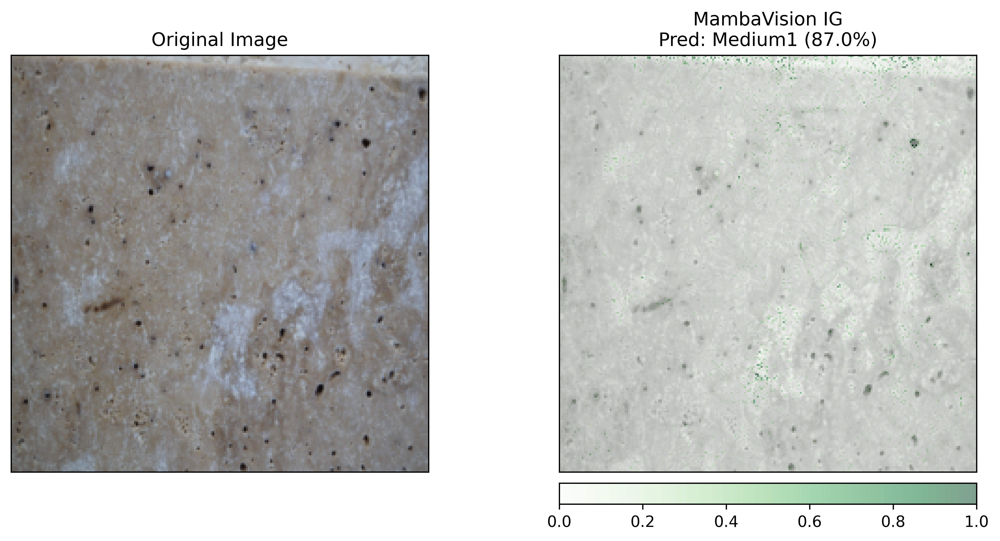
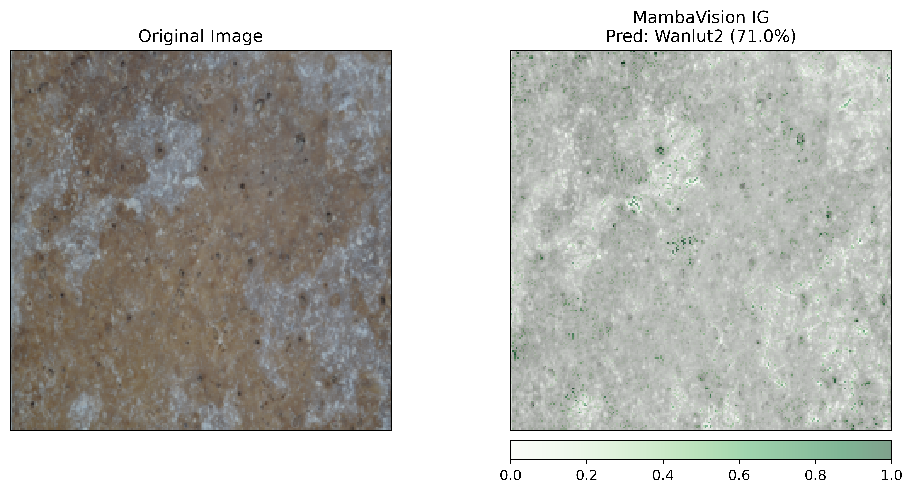
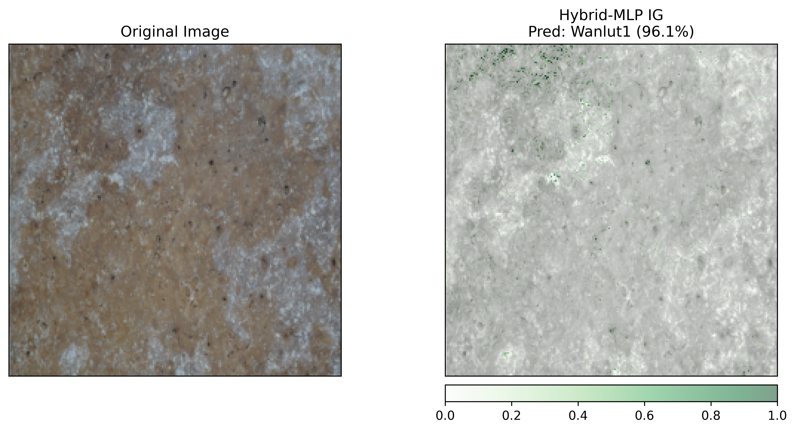
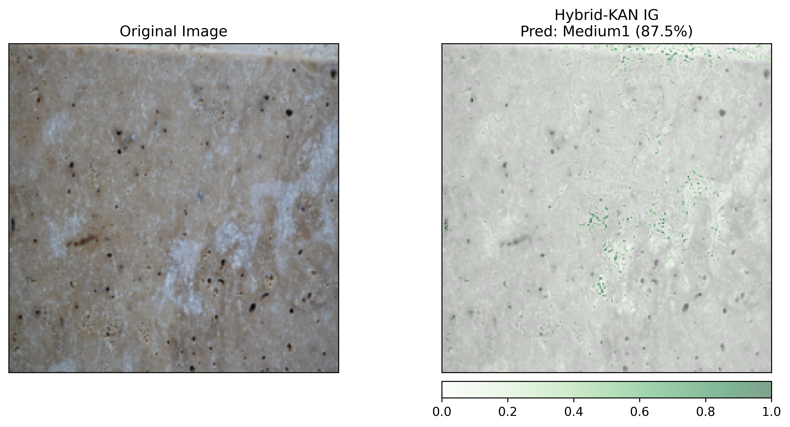
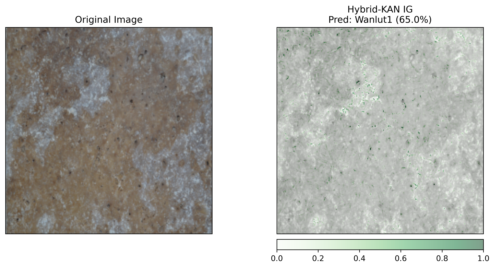

# XAI-VisionMamba-KAN-Ensemble

[](https://opensource.org/licenses/MIT)
[](https://www.python.org/downloads/)
[](https://pytorch.org/)

**Official PyTorch implementation of the XAI-driven heterogeneous ensemble framework combining Vision Mamba (Vim) and Kolmogorov-Arnold Networks (KAN) for explainable macroscopic texture classification.**

This repository contains the source code, training logs, and pre-trained weights for the article focusing on the reliable and transparent classification of macroscopic marble textures. The proposed heterogeneous soft-voting framework achieves a peak Macro F1-Score of 97.10% by mathematically fusing the macroscopic stability of Vision Mamba with the hyper-flexible, localized explainability of B-Spline KAN heads.

## 📌 Project Overview
* **Base Learner 1 (Vision Mamba):** Provides global contextual understanding and highly stable predictive variance.
* **Base Learner 2 (Hybrid ResNet-Mamba-KAN):** Leverages learnable B-spline activation functions to precisely map high-frequency 2D spatial anomalies (micro-textures).
* **XAI Validation:** Utilizes Axiomatic Integrated Gradients (IG) to prove the superior spatial interpretability of the KAN classification head over standard MLPs (Figure 4).

## 🔍 Explainability (XAI) Comparison: KAN vs. Standard MLP

To demonstrate the superior localized feature attribution of our proposed B-Spline KAN classification head, we applied Axiomatic Integrated Gradients (IG). The resulting heatmaps clearly show how the KAN head mathematically isolates micro-textures and capillary veins, unlike the diffuse global focus of the standard Vision Mamba or MLP heads.

| Architecture | Medium1 Class Example | Wanlut1 Class Example |
| :---: | :---: | :---: |
| **Pure Vision Mamba (Vim)**<br>*(Global Focus / Diffuse)* |  |  |
| **Hybrid ResNet-Mamba-MLP**<br>*(Standard Head / Generic)* |  |  |
| **Hybrid ResNet-Mamba-KAN**<br>*(Proposed / Hyper-Localized)* |  |  |

*Note: These visual proofs correspond to **Figure 4** of our manuscript.*

## 📂 Repository Structure

```text
XAI-VisionMamba-KAN-Ensemble/
│
├── dataset/                    
│   └── Marble/                 # Place your dataset class folders here (e.g., Medium1, Wanlut1)
│
├── logs/                       
│   ├── ablation_study_logs/    # Detailed 15-run CV logs (Train/Val Acc & Loss)
│   ├── checkpoints/            # Pre-trained model weights (.pth) should be placed here
│   └── xai_heatmaps/           # Generated Integrated Gradients heatmaps will be saved here
│
├── src/                        
│   ├── data_loader.py          # Strict zero-leakage 5-fold CV & Z-score normalization
│   ├── resnet_mamba_kan.py     # Fully integrated ResNet-Mamba-KAN architecture (Authentic B-Spline & Mamba SSM)
│   ├── ensemble.py             # Heterogeneous soft-voting fusion mechanism
│   ├── train.py                # 15-Run Stratified CV training execution
│   ├── get_xai_maps.py         # Extracts and visualizes Integrated Gradients
│   ├── generate_authentic_cm.py# Non-fabricated exact confusion matrix generator
│   └── calculate_table1.py     # Verified Table 1 standard deviation generator
│
└── requirements.txt            # Python dependencies