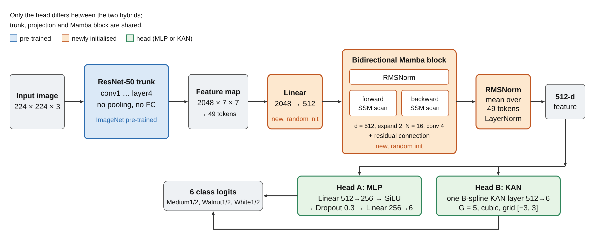

# Vision Mamba, ViT and ResNet–Mamba hybrids for marble texture classification

Code for the paper **"Vision Mamba, ViT and ResNet–Mamba Hybrids for Marble Texture Classification: A Controlled
Multi-Seed Comparison with MLP and KAN Heads, Soft-Voting Ensembles and Integrated Gradients"**
(M. Zontul, O. Kaynar, A. G. Yüksek, S. Karateke; *Applied Sciences*, submitted).

The repository contains the training, evaluation, statistics and explanation code of the controlled comparison:
996 expert-graded marble tile images in six classes, three seeds × stratified five-fold cross-validation
(15 runs per model), identical image-level splits for all models, one training recipe, and the **epoch-20 weights
only** (no checkpoint, epoch or fold selection).



## Models

| Name in the code | Model | Head |
|---|---|---|
| `vision_mamba` (`vim`) | Vim-S, official ImageNet-1k weights, 24 bidirectional SSM blocks, d = 384, 25.4 M parameters | Linear 384 → 6 |
| `vision_mamba_ctrl` (`vim2`) | Second Vim-S training (other head initialisation, data order, augmentation) | Linear 384 → 6 |
| `resnet_mamba_mlp` (`mlp`) | ResNet-50 trunk (ImageNet V2) + 2048 → 512 projection + one bidirectional Mamba block | MLP 512 → 256 → 6 |
| `resnet_mamba_kan` (`kan`) | same backbone as above | one B-spline KAN layer 512 → 6 (G = 5, cubic, grid [−3, 3]) |
| `resnet50` | ResNet-50 (torchvision V2 weights) | Linear 2048 → 6 |
| `vit_b16`, `vit_b16_mlp`, `vit_b16_kan` | ViT-B/16 (torchvision V1 weights) | Linear / MLP / KAN on 768-d features |

Ensembles (soft voting, unweighted mean of softmax outputs, no retraining): E1 Vim-S + ResNet–Mamba–KAN (primary),
E2 Vim-S + ResNet–Mamba–MLP, E3 Vim-S + second Vim-S, E4 the two hybrids, E5 Vim-S + both hybrids.

## Repository layout

```
.
├── README.md
├── requirements.txt
├── LICENSE, CITATION.cff
├── data/                      # put the dataset here (Zenodo, see data/README.md)
├── splits/                    # split files (validation indices of the 5 folds per seed)
├── preds/                     # per-run validation probabilities of all 8 models (120 files, epoch 20)
├── logs/                      # unedited training logs of the reported runs (+ README)
├── docs/figures/              # architecture figure (PNG, SVG)
├── results/                   # outputs of the analysis scripts
├── src/
│   ├── mamba_core.py          # selective scan (PyTorch + optional CUDA kernel), bidirectional mixer, ResNet+Mamba backbone
│   ├── vision_mamba_train.py  # Vim-S model definition and loading of the official checkpoint
│   ├── resnet_mamba_mlp.py    # hybrid with MLP head
│   ├── resnet_mamba_kan.py    # hybrid with B-spline KAN head
│   ├── master_train.py        # main training script (Vim-S, hybrids, Vim-S control)
│   ├── secondary_train.py     # ResNet-50 and ViT-B/16 (linear / MLP / KAN), same protocol
│   ├── ensemble_eval.py       # ensembles E1–E5, corrected resampled t-test, Holm, McNemar, error overlap
│   ├── make_table1.py         # accuracy / macro-F1 table of all single models (csv, md, tex)
│   ├── plot_learning_curves.py        # learning curves from the raw training logs
│   ├── plot_confusion_matrices.py     # pooled confusion matrices from the stored predictions
│   ├── xai_integrated_gradients.py    # Integrated Gradients and its quantitative checks
│   ├── figio.py               # figure export helpers
│   ├── check_cuda_backend.py  # compares the CUDA and PyTorch scan on a full Vim-S pass
│   └── old_models_epoch20.csv # values of the earlier manuscript version (Supplementary Table S1 only)
└── tests/                     # unit and smoke tests
```

## Installation

```bash
python -m venv .venv && source .venv/bin/activate        # Windows: .venv\Scripts\activate
pip install -r requirements.txt
```

* The study used Python 3.10, PyTorch 2.5.1 (CUDA 12.1), torchvision 0.20.1 on an Intel i9 (24 cores), 128 GB RAM and an
  NVIDIA GeForce RTX 4080 (16 GB). Install the PyTorch build that matches your CUDA version
  (<https://pytorch.org/get-started/locally/>).
* **Two environments were used in the study.** Vim-S ran under Ubuntu on WSL2 with the official CUDA selective-scan
  kernel (`pip install mamba-ssm==2.2.4`); all other models ran on Windows with the pure-PyTorch scan.
  Both evaluate the same recurrence; `src/check_cuda_backend.py` compares them. `--scan_backend auto|torch|cuda` selects the
  back-end.
* The pre-trained weights of ResNet-50 and ViT-B/16 come from torchvision and are downloaded automatically. The Vim-S
  checkpoint is downloaded from Hugging Face (`hustvl/Vim-small-midclstok`); pass `--vim_ckpt <file.pth>` for an offline copy.

## Reproducing the results

All commands are run from `src/`. `--out_dir` is the run directory; `weights/`, `preds/`, `results/` and `logs/` are created below it.

```bash
cd src
DATA=../data/Marble
RUN=../results/run

# 1. Time and memory estimate (optional)
python master_train.py --data $DATA --out_dir $RUN --benchmark

# 2. Vim-S, ResNet–Mamba–MLP, ResNet–Mamba–KAN and the second Vim-S (3 seeds x 5 folds each)
python master_train.py --data $DATA --out_dir $RUN --with_vim_control

# 3. ResNet-50 and ViT-B/16 with linear, MLP and KAN heads
python secondary_train.py --data $DATA --out_dir $RUN

# 4. Single-model table (Table 2), ensembles and statistics (Tables 3–4)
python make_table1.py   --run_dir $RUN
python ensemble_eval.py --run_dir $RUN

# 5. Figures
python plot_learning_curves.py   --logs $RUN/logs/*.txt
python plot_confusion_matrices.py --run_dir $RUN
python xai_integrated_gradients.py --run_dir $RUN --data $DATA --models vim kan mlp
```

Interrupted runs resume where they stopped (finished folds are skipped); `--no_resume` forces retraining.
Every run writes an unedited, time-stamped log, the epoch-20 weights, the validation probabilities
(`preds/*.npz`, used by the ensembles) and per-fold metrics (accuracy, macro-F1, per-class recall, confusion matrix).

Training protocol (identical for all models, `master_train.py --help` for all options): 20 epochs, AdamW
(learning rate 1e-4, weight decay 0.01), constant learning rate, batch size 32, focal loss (γ = 2), gradient-norm
clipping at 1.0, fp32 (TF32 matmul allowed), augmentation on training images only (random resized crop 224 × 224
with scale 0.8–1.0, horizontal and vertical flips, rotation by a multiple of 90°), seeds 42, 1024 and 2026,
per-run seed = seed × 100 + fold. Training uses deterministic cuDNN settings; reruns on the same software and hardware
should reproduce the numbers up to floating-point effects of the GPU.

## Tests

What each test checks is described in [`tests/README.md`](tests/README.md).

```bash
python tests/test_kan_and_hybrid.py     # KAN layer and hybrid backbone (CPU)
python tests/test_ensemble_eval.py      # ensemble and statistics code
python tests/test_make_table1.py
python tests/test_pipeline_smoke.py     # end-to-end smoke test on synthetic data (CPU)
python tests/test_plot_confusion.py
python tests/test_plot_curves.py
python tests/test_xai.py                # needs captum
```

Two tests compare the implementation with the official Mamba / Vim reference code and need a local copy of it
(`vim_ssi.py`, `vim_mamba_simple.py`, `models_mamba.py`, taken from <https://github.com/hustvl/Vim> and
<https://github.com/state-spaces/mamba>). Put the files in a folder and set `VIMSRC` (default `/tmp/vimsrc`):

```bash
VIMSRC=/path/to/reference python tests/test_scan_vs_official.py
VIMSRC=/path/to/reference python tests/test_vim_vs_official.py
```

## Group-wise splits

The images carry no tile identifiers, so the splits in the paper are at image level and the absolute accuracies are
likely optimistic. If tile or slab identifiers become available, pass `--groups_csv ids.csv` (columns `filename,group`) to
`master_train.py` and `secondary_train.py` for `StratifiedGroupKFold` splits.

## Known limitation: EXIF orientation

Images are read with PIL without applying the EXIF orientation tag. 113 of the 996 photographs (tags 6 and 8) were taken in
portrait orientation and therefore enter the models rotated by 90 degrees (disclosed in the paper). Applying
`PIL.ImageOps.exif_transpose` would change the results.

## Citation

```bibtex
@article{zontul_marble_mamba,
  title   = {Vision Mamba, ViT and ResNet--Mamba Hybrids for Marble Texture Classification: A Controlled Multi-Seed Comparison with MLP and KAN Heads, Soft-Voting Ensembles and Integrated Gradients},
  author  = {Zontul, Metin and Kaynar, O{\u{g}}uz and Y{\"u}ksek, A. G. and Karateke, Seda},
  journal = {Applied Sciences},
  year    = {2026},
  note    = {Submitted}
}
```

## License

The code is released under the MIT licence (`LICENSE`). The pre-trained weights keep their own licences (torchvision,
hustvl/Vim). The images are archived on Zenodo under CC BY 4.0 (<https://doi.org/10.5281/zenodo.24053101>).
